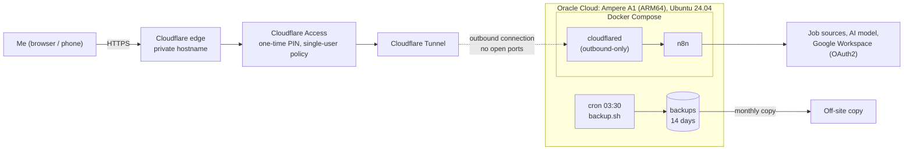
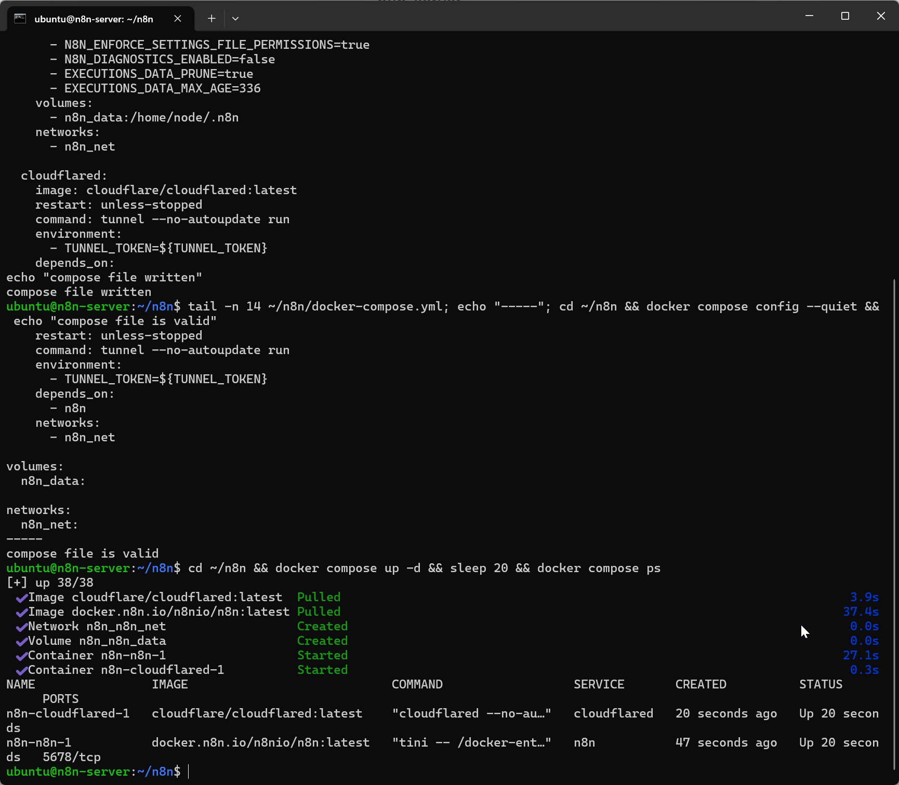
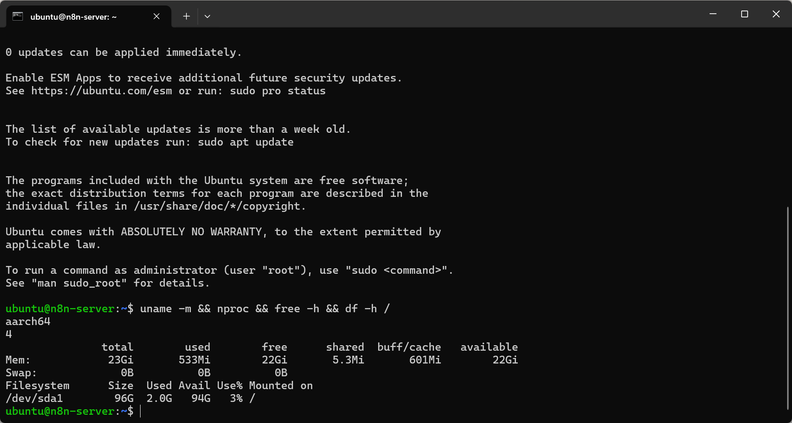
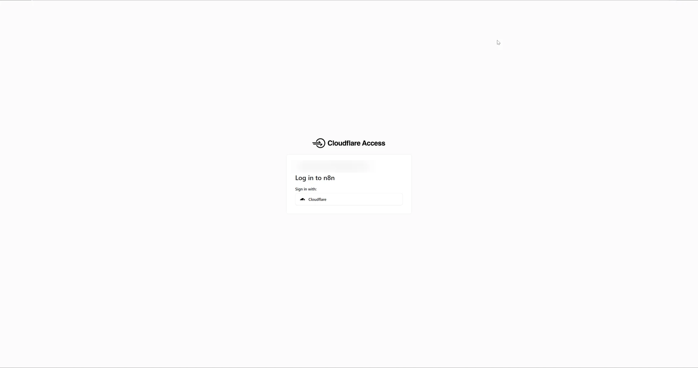
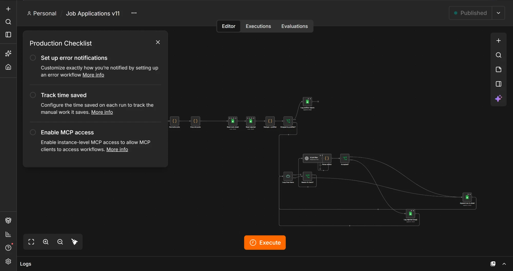

# Self-hosted n8n automation on Oracle Cloud

A production-style automation platform I designed and run: **n8n** in Docker on an Oracle Cloud ARM server,
reachable only through a **Cloudflare Tunnel** with **Cloudflare Access** in front: no open inbound ports, two login layers,
scheduled daily runs and nightly backups.

It powers my job search: every morning it collects job posts from four job boards, cleans and de-duplicates them,
then filters and AI-ranks the best matches into a shortlist. Work that used to take hours by hand now runs on its own.

> This repository documents the **architecture, infrastructure and operations**. The workflow logic itself is kept private.

Part of my portfolio: **https://alghuraid.com/projects/n8n-automation/**

---

## Results

- **~1,000 job posts processed → ~80 shortlisted** every day, unattended
- **Zero duplicates** on re-runs, across days
- **0 open inbound ports**: the server is reachable only through an outbound tunnel
- **Nightly backups** with 14-day retention, plus a monthly off-server copy
- The pipeline runs in the cloud on a schedule; it no longer depends on my laptop being on

## Architecture





## Stack

| Layer | Choice | Why |
|---|---|---|
| Compute | Oracle Cloud Ampere A1 (ARM64), 4 OCPU / 24 GB RAM | Plenty of headroom for large daily runs |
| OS | Ubuntu 24.04 LTS (aarch64) | Long-term support, first-class Docker support |
| Runtime | Docker Engine + Docker Compose | Reproducible setup, one-command updates |
| App | n8n (self-hosted) | Visual workflows with code where needed |
| Ingress | Cloudflare Tunnel (`cloudflared` container) | No inbound ports on the server; TLS at the edge |
| Auth | Cloudflare Access (email one-time PIN, allow-list of one) + n8n's own login | Two layers before anyone reaches n8n |
| DNS / domain | Cloudflare | DNS, tunnel and access policies in one place |
| Backups | Bash + cron, n8n CLI export | Workflows + credentials (credentials stay encrypted) |



## Security decisions

- **No open inbound ports for the app.** n8n is not published on the host; port 5678 exists only inside the Docker network. The only way in is the tunnel.
- **Two authentication layers:** a Cloudflare Access policy (one allowed email, one-time PIN), then n8n's owner login.
- **Lock first, publish second:** the Access policy was created *before* the public hostname, so n8n's first-run setup page was never exposed.
- **SSH key only** (RSA 4096 with a passphrase), no password login.
- **Secrets live only in a `chmod 600` `.env` on the server** (n8n encryption key, tunnel token) and in a password manager. Nothing secret is in this repository; see [`infra/.env.example`](infra/.env.example).
- **Separate Google OAuth client** for the cloud instance, so local and cloud can be rotated independently; consent screen in production to avoid 7-day token expiry.
- **Spending guardrails:** limits set on every paid API the workflows call.



## The pipeline at a glance



Collect → clean → de-duplicate against previous runs → filter → AI-assisted ranking → shortlist,
with every rejected post logged so the filters can be audited and tuned.

## Repository layout

```
.
├── README.md
├── infra/
│   ├── docker-compose.yml   ← n8n + cloudflared (hostname is a placeholder)
│   ├── .env.example         ← variable names only
│   ├── backup.sh            ← nightly export of workflows + encrypted credentials
│   └── crontab.txt
├── docs/
│   ├── setup-guide.md       ← how to rebuild the platform from zero
│   ├── operations.md        ← updates, backups, restore, health checks
│   └── lessons-learned.md   ← problems I hit and how I solved them
└── screenshots/
```

## Next steps

- Error-notification workflow (alert me when a run fails)
- Terraform for the Oracle network and instance, and a GitHub Actions job for image updates
- Postgres instead of SQLite if the number of workflows grows
